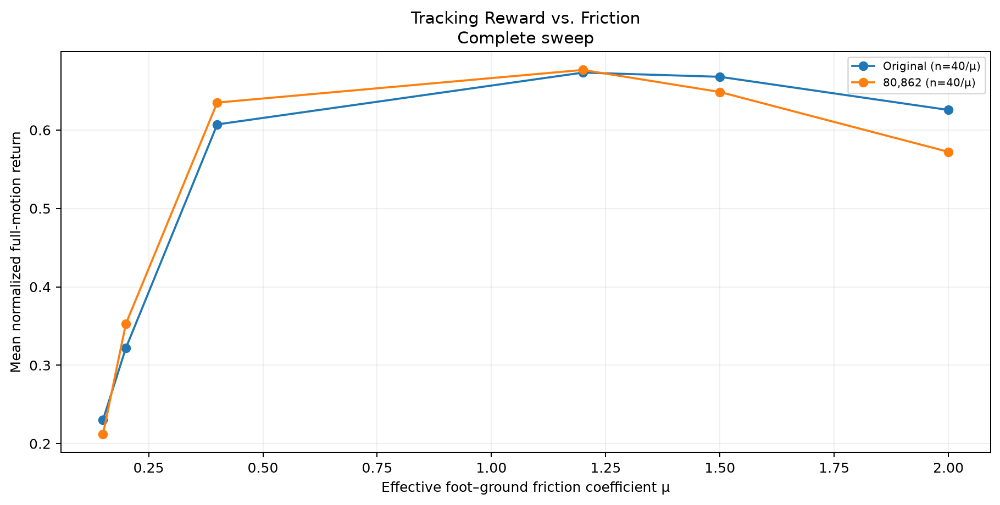
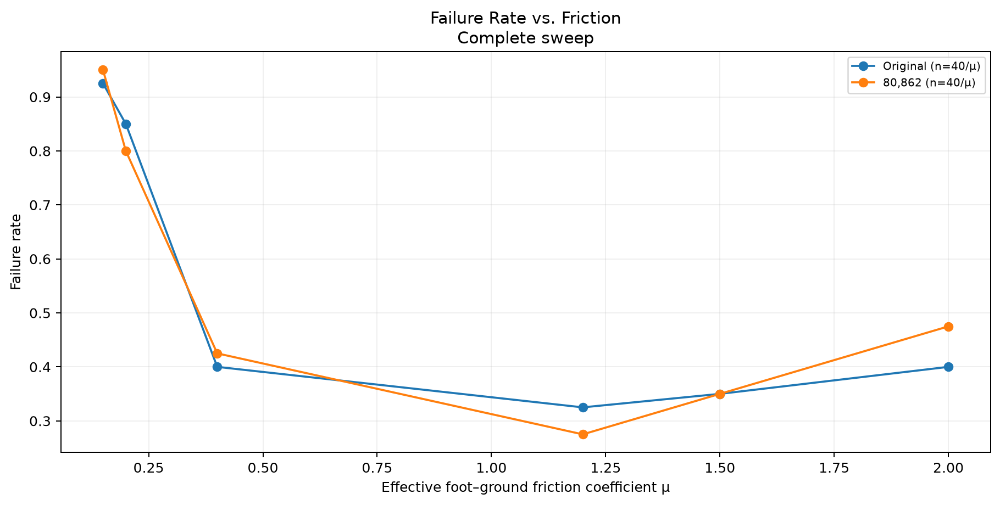
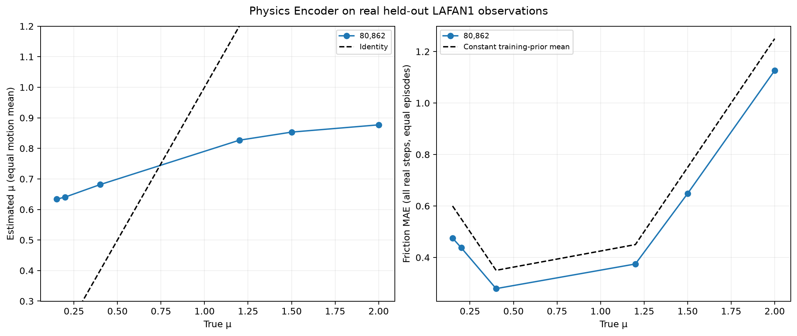

# Experiment 009：延长训练检查点评测

状态：完整；已完成 12/12 个条件，480 个 Episode。

比较策略：Original、80,862。没有新训练；使用相同 LAFAN1 完整动作、seed=0、原始物理设置和配对初始状态。仅在包含 disabled 对照时提供数值重复性参照。
训练摩擦支持范围为 [0.3, 1.2]；范围内新取值不等于范围外泛化。Encoder 输出被限制在 [0.3, 1.2]，无法准确预测范围外真值；范围外控制鲁棒性与参数估计准确性应分别解释。

## 跟踪表现

| μ | 策略/检查点 | 平均归一化回报 | 失败数 / Episode数 | 容量标记 Episode数 |
|---|---|---:|---:|---:|
| 0.4 | Original | 0.6071 | 16/40 | 0 |
| 0.4 | 80,862 | 0.6350 | 17/40 | 0 |
| 0.2 | Original | 0.3218 | 34/40 | 0 |
| 0.2 | 80,862 | 0.3527 | 32/40 | 0 |
| 0.15 | Original | 0.2303 | 37/40 | 0 |
| 0.15 | 80,862 | 0.2118 | 38/40 | 0 |
| 1.2 | Original | 0.6732 | 13/40 | 0 |
| 1.2 | 80,862 | 0.6766 | 11/40 | 0 |
| 1.5 | Original | 0.6678 | 14/40 | 0 |
| 1.5 | 80,862 | 0.6485 | 14/40 | 0 |
| 2 | Original | 0.6256 | 16/40 | 0 |
| 2 | 80,862 | 0.5721 | 19/40 | 0 |

## 相对原策略的配对回报变化

区间为按动作 Episode 重采样的描述性 bootstrap 95% 区间；没有把连续帧当作独立样本。

| μ | 检查点 | Δ回报 | 区间 | Disabled–Base平均绝对差 |
|---|---|---:|---|---:|
| 0.15 | 80,862 | -0.0185 | [-0.0580, +0.0119] | 未设置 |
| 0.2 | 80,862 | +0.0309 | [+0.0030, +0.0648] | 未设置 |
| 0.4 | 80,862 | +0.0279 | [-0.0191, +0.0869] | 未设置 |
| 1.2 | 80,862 | +0.0034 | [-0.0123, +0.0269] | 未设置 |
| 1.5 | 80,862 | -0.0194 | [-0.0534, +0.0052] | 未设置 |
| 2 | 80,862 | -0.0534 | [-0.1206, +0.0092] | 未设置 |

## Physics Encoder 输出

均值按动作等权；分位数来自每0.5秒采样的真实观测，受动作时长和提前失败影响。MAE使用每一个实际执行步，再按 Episode 等权。

| μ | 检查点 | 预测均值 | 预测10%–90% | 全步MAE | 常数0.75 MAE |
|---|---|---:|---|---:|---:|
| 2 | 80,862 | 0.8770 | 0.7209–1.0204 | 1.1263 | 1.2500 |
| 1.5 | 80,862 | 0.8533 | 0.7096–0.9983 | 0.6484 | 0.7500 |
| 1.2 | 80,862 | 0.8268 | 0.6836–0.9711 | 0.3746 | 0.4500 |
| 0.4 | 80,862 | 0.6814 | 0.4891–0.8449 | 0.2789 | 0.3500 |
| 0.2 | 80,862 | 0.6407 | 0.4439–0.8070 | 0.4376 | 0.5500 |
| 0.15 | 80,862 | 0.6337 | 0.4244–0.8005 | 0.4754 | 0.6000 |

## 结论限制

- 没有以 LAFAN1 调整训练损失或选择新的训练参数；所有指定检查点都报告，不事后只挑最好值。
- 数值容量标记与求解器迭代上限分开记录。带容量错误的失败不能直接归因于模型；共同干净子集的结果保留在 paired_effects.csv，属于条件性诊断。
- Disabled 与原策略在相同观测下动作精确一致，但长序列重复仿真仍可能分歧。单个重复对照不足以完整估计数值变异；小变化需要更多重复或数值控制。
- Encoder 输出变化或跟踪改善均不能单独证明识别了摩擦、或控制收益来自这个标量；还需要常数/打乱估计等推断对照。
- 训练指标退化或验证差异不能单独证明过拟合；采样分布、模型偏差与数值变化都需区分。
- 当前脚部摩擦干预与训练 ξ 定义一致，不是全身所有接触都采用统一低摩擦。滑移速度未可靠测量，不编造数值。

## 图表

图表同时提供 PDF；原始 group JSON 含逐动作结果、真实预测帧、接触证据、运行耗时与数值标记。
