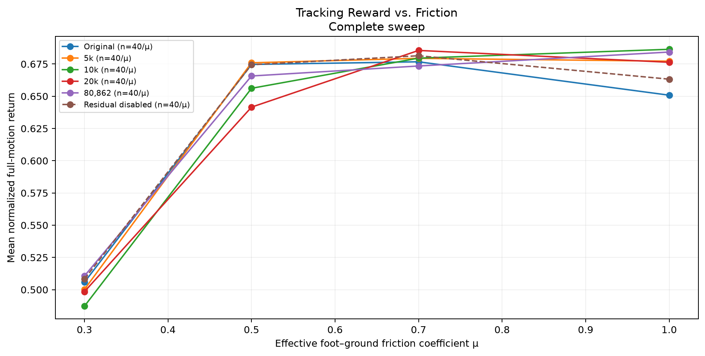
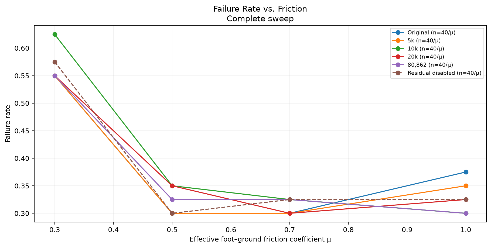
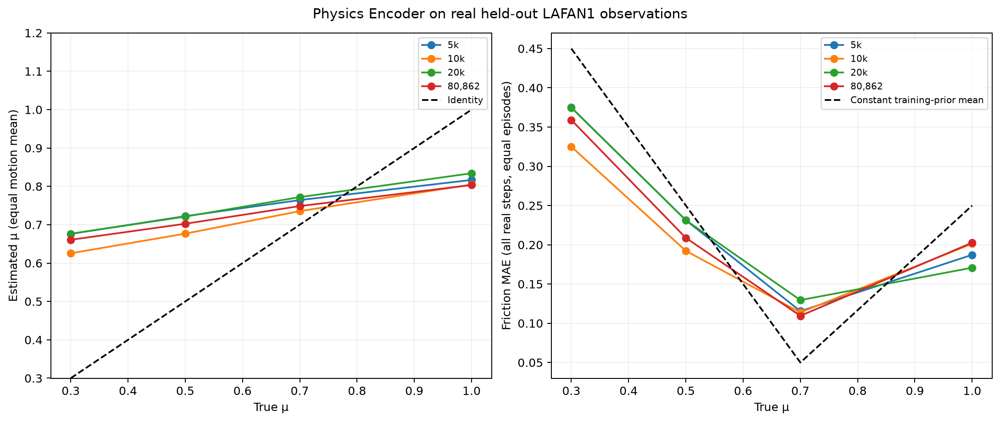

# Experiment 009：延长训练检查点评测

状态：完整；已完成 24/24 个条件，960 个 Episode。

比较策略：Original、80,862、5k、10k、20k、Residual disabled。没有新训练；使用相同 LAFAN1 完整动作、seed=0、原始物理设置和配对初始状态。仅在包含 disabled 对照时提供数值重复性参照。
训练摩擦支持范围为 [0.3, 1.2]；范围内新取值不等于范围外泛化。Encoder 输出被限制在 [0.3, 1.2]，无法准确预测范围外真值；范围外控制鲁棒性与参数估计准确性应分别解释。

## 跟踪表现

| μ | 策略/检查点 | 平均归一化回报 | 失败数 / Episode数 | 容量标记 Episode数 |
|---|---|---:|---:|---:|
| 1 | Original | 0.6508 | 15/40 | 0 |
| 1 | 5k | 0.6772 | 14/40 | 0 |
| 1 | 10k | 0.6864 | 12/40 | 0 |
| 1 | 20k | 0.6763 | 13/40 | 0 |
| 1 | 80,862 | 0.6843 | 12/40 | 0 |
| 1 | Residual disabled | 0.6632 | 13/40 | 0 |
| 0.7 | Original | 0.6767 | 12/40 | 0 |
| 0.7 | 5k | 0.6794 | 12/40 | 0 |
| 0.7 | 10k | 0.6796 | 13/40 | 0 |
| 0.7 | 20k | 0.6855 | 12/40 | 0 |
| 0.7 | 80,862 | 0.6735 | 13/40 | 0 |
| 0.7 | Residual disabled | 0.6814 | 13/40 | 0 |
| 0.5 | Original | 0.6747 | 12/40 | 0 |
| 0.5 | 5k | 0.6760 | 12/40 | 0 |
| 0.5 | 10k | 0.6562 | 14/40 | 0 |
| 0.5 | 20k | 0.6416 | 14/40 | 0 |
| 0.5 | 80,862 | 0.6657 | 13/40 | 0 |
| 0.5 | Residual disabled | 0.6745 | 12/40 | 0 |
| 0.3 | Original | 0.5058 | 22/40 | 0 |
| 0.3 | 5k | 0.5002 | 22/40 | 0 |
| 0.3 | 10k | 0.4872 | 25/40 | 0 |
| 0.3 | 20k | 0.4985 | 22/40 | 0 |
| 0.3 | 80,862 | 0.5106 | 22/40 | 0 |
| 0.3 | Residual disabled | 0.5083 | 23/40 | 0 |

## 相对原策略的配对回报变化

区间为按动作 Episode 重采样的描述性 bootstrap 95% 区间；没有把连续帧当作独立样本。

| μ | 检查点 | Δ回报 | 区间 | Disabled–Base平均绝对差 |
|---|---|---:|---|---:|
| 0.3 | 10k | -0.0186 | [-0.0563, +0.0138] | 0.0595 |
| 0.5 | 10k | -0.0185 | [-0.0473, +0.0040] | 0.0021 |
| 0.7 | 10k | +0.0028 | [-0.0137, +0.0258] | 0.0168 |
| 1 | 10k | +0.0356 | [+0.0059, +0.0717] | 0.0463 |
| 0.3 | 20k | -0.0073 | [-0.0257, +0.0116] | 0.0595 |
| 0.5 | 20k | -0.0331 | [-0.0774, -0.0004] | 0.0021 |
| 0.7 | 20k | +0.0088 | [-0.0034, +0.0293] | 0.0168 |
| 1 | 20k | +0.0255 | [-0.0005, +0.0610] | 0.0463 |
| 0.3 | 5k | -0.0056 | [-0.0324, +0.0231] | 0.0595 |
| 0.5 | 5k | +0.0013 | [-0.0004, +0.0034] | 0.0021 |
| 0.7 | 5k | +0.0027 | [-0.0053, +0.0138] | 0.0168 |
| 1 | 5k | +0.0264 | [-0.0032, +0.0614] | 0.0463 |
| 0.3 | 80,862 | +0.0049 | [-0.0279, +0.0380] | 0.0595 |
| 0.5 | 80,862 | -0.0089 | [-0.0259, +0.0012] | 0.0021 |
| 0.7 | 80,862 | -0.0033 | [-0.0129, +0.0024] | 0.0168 |
| 1 | 80,862 | +0.0335 | [+0.0046, +0.0699] | 0.0463 |

## Physics Encoder 输出

均值按动作等权；分位数来自每0.5秒采样的真实观测，受动作时长和提前失败影响。MAE使用每一个实际执行步，再按 Episode 等权。

| μ | 检查点 | 预测均值 | 预测10%–90% | 全步MAE | 常数0.75 MAE |
|---|---|---:|---|---:|---:|
| 1 | 5k | 0.8168 | 0.6848–0.9514 | 0.1872 | 0.2500 |
| 1 | 10k | 0.8047 | 0.6500–0.9663 | 0.2013 | 0.2500 |
| 1 | 20k | 0.8341 | 0.6734–0.9772 | 0.1708 | 0.2500 |
| 1 | 80,862 | 0.8035 | 0.6542–0.9470 | 0.2027 | 0.2500 |
| 0.7 | 5k | 0.7642 | 0.5890–0.9093 | 0.1154 | 0.0500 |
| 0.7 | 10k | 0.7354 | 0.5479–0.9073 | 0.1138 | 0.0500 |
| 0.7 | 20k | 0.7720 | 0.5733–0.9317 | 0.1295 | 0.0500 |
| 0.7 | 80,862 | 0.7486 | 0.5736–0.8990 | 0.1095 | 0.0500 |
| 0.5 | 5k | 0.7223 | 0.5208–0.8759 | 0.2313 | 0.2500 |
| 0.5 | 10k | 0.6768 | 0.4747–0.8574 | 0.1922 | 0.2500 |
| 0.5 | 20k | 0.7212 | 0.5029–0.8923 | 0.2313 | 0.2500 |
| 0.5 | 80,862 | 0.7025 | 0.5136–0.8587 | 0.2088 | 0.2500 |
| 0.3 | 5k | 0.6761 | 0.4781–0.8451 | 0.3749 | 0.4500 |
| 0.3 | 10k | 0.6255 | 0.4262–0.8136 | 0.3250 | 0.4500 |
| 0.3 | 20k | 0.6766 | 0.4600–0.8591 | 0.3747 | 0.4500 |
| 0.3 | 80,862 | 0.6608 | 0.4730–0.8259 | 0.3590 | 0.4500 |

## 结论限制

- 没有以 LAFAN1 调整训练损失或选择新的训练参数；所有指定检查点都报告，不事后只挑最好值。
- 数值容量标记与求解器迭代上限分开记录。带容量错误的失败不能直接归因于模型；共同干净子集的结果保留在 paired_effects.csv，属于条件性诊断。
- Disabled 与原策略在相同观测下动作精确一致，但长序列重复仿真仍可能分歧。单个重复对照不足以完整估计数值变异；小变化需要更多重复或数值控制。
- Encoder 输出变化或跟踪改善均不能单独证明识别了摩擦、或控制收益来自这个标量；还需要常数/打乱估计等推断对照。
- 训练指标退化或验证差异不能单独证明过拟合；采样分布、模型偏差与数值变化都需区分。
- 当前脚部摩擦干预与训练 ξ 定义一致，不是全身所有接触都采用统一低摩擦。滑移速度未可靠测量，不编造数值。

## 图表

图表同时提供 PDF；原始 group JSON 含逐动作结果、真实预测帧、接触证据、运行耗时与数值标记。
